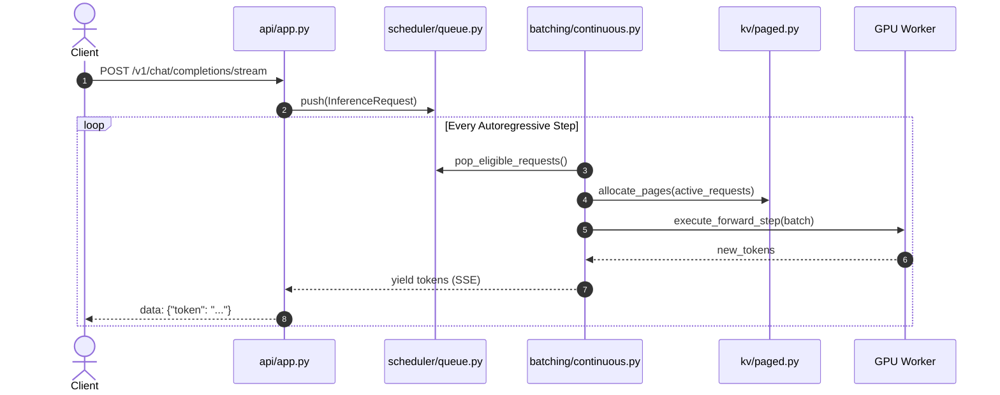

# Full Project Analysis: LLM Inference Scheduler

## System Trace & Component Interaction

### Final Baseline Inventory Counts
- **Total Backend Python Modules**: 22 modules across `scheduler/`, `batching/`, `kv/`, `coordination/`
- **Total Passing Automated Tests**: 99 tests (`backend/tests/`)
- **Total Frontend Dashboard Components**: 5 React components (`frontend/src/`)
